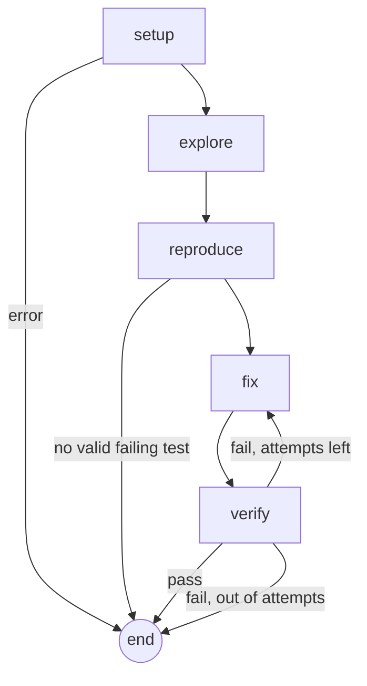

# RepoDoctor

**An agent that reads a GitHub issue, writes a failing test that reproduces it, fixes the code inside a locked-down Docker sandbox, and checks the fix against the project's own test suite.**

Built with [LangGraph](https://langchain-ai.github.io/langgraph/) and [LangChain](https://python.langchain.com/), traced with [LangSmith](https://smith.langchain.com/), and run on free NVIDIA Nemotron models.

> **Status: research prototype.** The fix loop and the evaluation harness work end to end. The agent does **not** open pull requests yet, and nothing it produces is ever pushed anywhere. Measured resolve rates are in [Results](#results), together with the reasons not to over-read them.

---

## Contents

- [What it does](#what-it-does)
- [Design goals](#design-goals)
- [How it works](#how-it-works)
- [Safety model](#safety-model)
- [Setup (Windows)](#setup-windows)
- [Configuration reference](#configuration-reference)
- [Usage](#usage)
- [Evaluation method](#evaluation-method)
- [Results](#results)
- [Project layout](#project-layout)
- [Development](#development)
- [Troubleshooting](#troubleshooting)
- [Responsible use](#responsible-use)
- [Status and roadmap](#status-and-roadmap)
- [License](#license)

---

## What it does

Give it an issue. It does the following:

1. **Sets up** the repository in a Docker sandbox and records which tests already fail (the *baseline*).
2. **Explores** the code with read-only search tools and names the files most likely involved.
3. **Reproduces** the bug by writing a new pytest test, and accepts it only if it fails *for the right reason* on the unmodified code.
4. **Fixes** the bug by proposing exact search/replace edits. If it needs another file it can ask for one without spending an attempt.
5. **Verifies**: the new test must pass, and no test that passed before may fail now. If verification fails, the failure output goes back to the fixer for another attempt (three at most).

Example, on a real closed issue in [`python-humanize/humanize`](https://github.com/python-humanize/humanize), replayed on the code as it was before the maintainers' fix:

```text
> uv run repodoctor fix-issue https://github.com/python-humanize/humanize/issues/154 --replay --fix-pr 169
Issue:    naturaldelta failing with float input and sub-second precision [closed]
Replay:   code as of c8a8d330d3, before the fix in PR #169

Relevant files: src/humanize/time.py
Hypothesis:     value = int(value) truncates 0.5 to 0, so the sub-second part is lost ...
Generated test: tests/test_repodoctor_repro.py::test_naturaldelta_float_subsecond_milliseconds
                (accepted on attempt 1)
Fix attempts:   1/3

--- a/src/humanize/time.py
+++ b/src/humanize/time.py
@@ -131,8 +131,7 @@ def naturaldelta(
-            value = int(value)
-            delta = dt.timedelta(seconds=value)
+            delta = dt.timedelta(seconds=float(value))

RESULT: SUCCESS (nothing was pushed; the diff above is the change)
Compare with the real fix: https://github.com/python-humanize/humanize/pull/169
```

---

## Design goals

- **Evidence over confidence.** A fix counts only if a test that failed for the right reason now passes and nothing regressed. The model's opinion of its own work is never the success signal.
- **Measured, not demoed.** A SWE-bench-style harness grades the agent with the *maintainers'* tests, which the agent never sees. See [Evaluation method](#evaluation-method).
- **Honest numbers.** Rules for counting results are written before runs, deviations are recorded, and cases are reviewed for fairness from the issue text alone.
- **Safe by construction.** Repository allowlist, sandboxed execution, read-only agent tools, dry-run by default, and untrusted-input handling for issue text.
- **Cheap to run.** Free-tier models, small steps. Every model is a config value.
- **Small and testable.** Deterministic tools are separate from LLM nodes, and the graph is only wiring. Nodes can be tested with fake models and a fake sandbox.

---

## How it works



| Node | LLM | What it does |
|---|---|---|
| `setup` | no | Installs dependencies (network on), cuts the network, runs the full test suite to record the **baseline**, notes the starting commit. |
| `explore` | yes (tools) | A bounded loop with four read-only tools (`grep_code`, `find_definition`, `read_file`, `list_dir`), then a structured answer: relevant files and a root-cause hypothesis. Paths that do not exist get one correction round. |
| `reproduce` | yes (structured) | Writes one new test file and **validates it in the sandbox**. Up to 3 tries, with the rejection reason fed back. Skipped if you pass `--test`. |
| `fix` | yes (structured) | Resets the tree, then proposes `old`/`new` edits from the full text of the relevant files and the history of failed attempts. May request more files (`need_more_files`); up to `FIX_CONTEXT_ROUNDS` such requests are answered **within the same attempt**. |
| `verify` | no | Runs the target test, then the full suite, and compares it with the baseline. |

### Design decisions worth knowing

- **Search/replace edits, not diffs.** Each edit carries the exact `old` text, which must occur exactly once. Edits apply atomically, tolerate CRLF files, reject path traversal and `.git`, and failures come back to the model as readable messages. The real diff is then generated by `git`.
- **Baseline comparison.** Real projects have tests that already fail. The agent ignores pre-existing failures and rejects only *new* ones.
- **The reproduction gate.** A generated test is rejected if it has a syntax error, passes on the unmodified code, times out, errors during collection, or fails with `ImportError`, `NameError` and similar. If no valid test comes out, the run **stops before attempting any fix**.
- **Protected tests.** The agent cannot edit the target test files. Updating *other* existing tests is off by default (`ALLOW_TEST_UPDATES`).
- **Clean retries.** Before every attempt the tree is reset to the last commit; build artifacts from the install step survive.
- **Replay mode.** For a closed issue, the agent runs on the repository **as it was just before the fixing PR**. It never sees the PR.
- **Resilient model calls.** Each model has a hard wall-clock deadline, fallbacks are tried in order, and malformed or empty structured output counts as a failed attempt, not a crash.
- **Untrusted text.** Issue text is wrapped in tags it cannot close, and every prompt says to treat it as data.

---

## Safety model

| Risk | Mitigation |
|---|---|
| Running code from a repository | Docker container with dropped capabilities, `no-new-privileges`, memory, CPU and process limits, a hard timeout on every command, and only the cloned repo mounted. |
| Network abuse | The network is **disconnected after dependency install**, so tests run offline. |
| Agent touches the wrong repo | `ALLOWED_REPOS` allowlist, enforced before any clone. |
| Agent edits your files | It works on a fresh clone in `.repodoctor/work/`. |
| Prompt injection via issue text | Delimited untrusted input, read-only tools, no secrets in the sandbox or prompts. |
| Cheating by editing tests | Target tests are protected. At grading time the maintainers' test files overwrite the agent's. |
| Accidentally pushing something | There is no push code yet, and `DRY_RUN=true` is the default. |
| Runaway cost or time | Hard caps on attempts, explorer steps, context size, per-call deadline and per-run time. |

**Limitations you should understand:**

- The **dependency install step runs with the network on and executes the repository's build scripts.** Only allowlist repositories you are willing to execute code from.
- A **pip cache volume is shared between sandbox containers** to speed up installs, so a malicious build script could poison it. Reset it with `docker volume rm repodoctor-pip-cache`.
- Docker is a strong boundary but not a perfect one. Do not point this at repositories you do not trust.
- Contribution policies of third-party projects are your responsibility. See [Responsible use](#responsible-use).

---

## Setup (Windows)

Developed and tested on Windows 11 with PowerShell. The code is cross-platform Python, but I have not tested Linux or macOS.

### 1. Prerequisites

```powershell
winget install --id=astral-sh.uv -e
winget install --id=Git.Git -e
winget install --id=Docker.DockerDesktop -e
winget install --id=BurntSushi.ripgrep.MSVC -e   # optional (the agent uses `git grep`)

git config --global core.autocrlf input    # keep LF: exact-match patching depends on it
git config --global core.longpaths true
```

Open a **new** terminal afterwards (PATH changes only reach new windows) and start Docker Desktop once so its first-run setup (WSL 2) completes.

### 2. Get the code

```powershell
git clone https://github.com/princ0301/RepoDoctor.git
cd RepoDoctor
uv sync
```

### 3. API keys

| Key | Where | Required | Notes |
|---|---|---|---|
| `NVIDIA_API_KEY` | [build.nvidia.com](https://build.nvidia.com) (starts `nvapi-`) | recommended | Free credits. |
| `OPENROUTER_API_KEY` | [openrouter.ai](https://openrouter.ai) | recommended | Free `:free` models, tightly rate limited. Good as a fallback. |
| `GITHUB_TOKEN` | GitHub, Settings, Developer settings | optional | Only raises the API limit (60 to 5,000 per hour). Create a token with **no scopes**. |
| `LANGSMITH_API_KEY` | [smith.langchain.com](https://smith.langchain.com) | optional | Traces for every run. |

At least one of the NVIDIA or OpenRouter keys is needed.

### 4. Configure

Copy `.env.example` to `.env` (no quotes, no spaces around `=`; `.env` is git-ignored):

```ini
NVIDIA_API_KEY=
OPENROUTER_API_KEY=
GITHUB_TOKEN=
GITHUB_USERNAME=

ALLOWED_REPOS=python-humanize/humanize,pallets/click,andialbrecht/sqlparse,prettytable/prettytable
DRY_RUN=true

LLM_EXPLORE=nvidia:nvidia/nemotron-3.5-lightning-30b-a3b
LLM_FIX=nvidia:nvidia/nemotron-3.5-super-vl-120b-a12b
LLM_FALLBACKS=openrouter:nvidia/nemotron-3.5-super-vl:free

LANGSMITH_TRACING=true
LANGSMITH_API_KEY=
LANGSMITH_PROJECT=repodoctor-dev
```

### 5. Check everything

```powershell
uv run repodoctor doctor        # tools, keys, allowlist, selected models
uv run repodoctor check-llm     # live test of every configured model
```

`check-llm` verifies that **tool calling** and **structured output** work for each model. A model appearing in `nvidia-models` does not guarantee it can be called, so trust `check-llm`.

---

## Configuration reference

All settings are environment variables (read from `.env`).

| Variable | Default | Meaning |
|---|---|---|
| `NVIDIA_API_KEY`, `OPENROUTER_API_KEY` | empty | Provider credentials |
| `GITHUB_TOKEN`, `GITHUB_USERNAME` | empty | GitHub API access |
| `ALLOWED_REPOS` | empty | Comma-separated `owner/repo` list the agent may work on |
| `DRY_RUN` | `true` | Reserved for the PR step: never push or open a PR |
| `LLM_EXPLORE` / `LLM_FIX` | `openrouter:nvidia/nemotron-3.5-super-vl:free` | Models for exploring, and for the test writer and fixer |
| `LLM_FALLBACKS` | empty | Comma-separated models tried when the primary fails |
| `LLM_TIMEOUT_S`, `LLM_MAX_RETRIES` | `120`, `2` | Per-request client settings |
| `LLM_CALL_DEADLINE_S` | `240` | Hard wall-clock limit per model call; a timeout moves on to the fallback |
| `MAX_ATTEMPTS` | `3` | Fix/verify tries per run |
| `REPRO_MAX_ATTEMPTS` | `3` | Tries to produce a valid reproduction test |
| `EXPLORE_MAX_STEPS` | `10` | Tool-calling rounds in the explorer |
| `FIX_CONTEXT_CHARS` | `240000` | Budget for source files shown to the fixer |
| `FIX_CONTEXT_ROUNDS` | `2` | Free file requests per fix attempt (`0` restores the old behavior) |
| `ALLOW_TEST_UPDATES` | `false` | Let the fixer update an existing test that contradicts the issue |
| `RUN_TIMEOUT_S` | `900` | Checked between steps; `0` disables |
| `SANDBOX_TIMEOUT_S`, `SANDBOX_MEMORY`, `SANDBOX_CPUS` | `300`, `2g`, `2.0` | Per test run, and container limits |
| `BUILD_INSTALL_TIMEOUT_S`, `BUILD_STEP_TIMEOUT_S` | `300`, `240` | Limits used when building evaluation cases |
| `WORK_DIR` | `.repodoctor/work` | Where repositories are cloned |

Models are `provider:model` with provider `nvidia` or `openrouter`. To add another OpenAI-compatible provider, add an entry to `ENDPOINTS` in `src/repodoctor/models.py`. Per-repository test overrides live in `evals/repo_overrides.json` (for example, werkzeug's `tests/test_serving.py` hangs in the sandbox and is skipped).

---

## Usage

### Quick start: a seeded bug

```powershell
uv run repodoctor make-demo
```
This creates two tiny repositories with the same bug and prints a ready-to-run command for each: one with a failing test already in place (`--test`), and one where the agent has to write the test itself. The first run builds the sandbox image, which takes a few minutes.

### A real GitHub issue

```powershell
uv run repodoctor fix-issue https://github.com/OWNER/REPO/issues/123               # open issue
uv run repodoctor fix-issue https://github.com/OWNER/REPO/issues/123 --replay      # closed: code before the fix
uv run repodoctor fix-issue URL --replay --fix-pr 456                              # name the fixing PR yourself
uv run repodoctor fix-issue URL --test tests/test_x.py::test_bug                   # your own failing test
```
`fix-issue` warns if the issue is assigned, and prints lines of the project's contribution docs that mention AI. The repository must be in `ALLOWED_REPOS`.

### A local repository

```powershell
uv run repodoctor fix --repo-dir PATH --issue-file ISSUE.md [--test TEST_ID]
```

### All commands

| Command | Purpose |
|---|---|
| `doctor`, `check-llm`, `nvidia-models` | Environment, model checks, model discovery |
| `check-issue`, `inspect`, `smoke` | Validate an issue URL; detect test setup; run a repo's tests in the sandbox (`--durations N`, `--per-file` to find hanging test files) |
| `make-demo`, `fix`, `fix-issue` | Run the agent |
| `eval-discover`, `eval-build` | Find and validate evaluation cases |
| `eval-run`, `eval-report`, `eval-failures`, `eval-compare` | Run the agent on cases, inspect and compare results |
| `eval-inspect`, `eval-gold`, `eval-recheck` | Review cases for fairness (issue and PR text, the maintainers' tests, pairing checks) |

Every run is traced to LangSmith when enabled, under names like `fix:owner/repo#123`.

---

## Evaluation method

A demo that works once proves little: the same issue can take three attempts one time and one the next. The harness follows [SWE-bench](https://www.swebench.com/) and uses real issues whose fixes are known.

### How a case is built and graded

Each case is a closed issue with one merged fixing PR (`eval-build`):

1. Take the repository at the PR's **base commit**.
2. Apply the PR's test files and run them: tests that fail are *fail-to-pass* candidates.
3. Apply **only the files the PR changed** to the base tree and run the same tests.
   - **fail-to-pass:** failed before, pass after the real fix.
   - **pass-to-pass:** passed both times.
4. Reject the case if nothing is fail-to-pass, the install fails, a test run exceeds its limit, or the PR is too large.

After an agent run, the maintainers' test files are copied over the agent's tree, and the run is **resolved** only if **every fail-to-pass and pass-to-pass test passes**. The agent's own reproduction test plays no part in grading. Tests that exist only in the PR (new test functions, and renumbered parametrize ids) are flagged as possibly unseen by the agent; they are an upper bound, not an exact count.

### Fairness review

Many issue and PR pairs are not fair tests: the maintainers' tests may pin names or exact output that the issue never states. Every case is reviewed **from the issue, the PR text and the test code, never from how the agent performed**, and tagged in `evals/case_flags.txt`:

| Tag | Meaning | Effect |
|---|---|---|
| `[spec]` | The tests need something the issue does not state | Skipped |
| `[scope]` | The tests need the fix to generalize beyond the reported instance | Kept in the headline, reported separately |
| `[infra]` | The harness cannot run the case | Skipped |

### Splits and counting rules

- **Dev** cases (`evals/dev_ids.txt`) are for tuning. **Held-out** cases are measured once on a frozen version (`git tag agent-frozen-for-heldout`). Cases studied after a measurement become dev cases, and a fresh held-out set is built.
- Counting rules are set **before** a run. Only infrastructure failures (models unavailable, or setup failed before any model call) are re-run. Every other outcome counts as it fell.
- Reported metrics: resolve rate, precision (resolved / agent said success), solved in at least one trial (pass@k), attempts, time, calls per model.

### Outcomes

| Outcome | Meaning |
|---|---|
| `resolved` | Passes the maintainers' tests |
| `wrong_fix` | The agent said success, but the maintainers' tests fail |
| `unseen_test` | Like `wrong_fix`, but only tests absent from the base repository fail |
| `fix_failed` | Out of attempts |
| `no_repro` | No valid failing test, so no fix attempted |
| `explore_failed`, `model_error`, `setup_error`, `baseline_failed`, `run_timeout`, `crash` | Infrastructure or robustness failures |

---

## Results

All numbers come from free models and a small, script-selected set of cases. Read them with the caveats at the end of this section.

### Round 1: frozen agent, held-out cases

Frozen at tag `agent-frozen-for-heldout` (commit `08e446a`), run once on 2026-11-04. `nemotron-3.5-lightning-30b-a3b` explored, `nemotron-3.5-super-vl-120b-a12b` wrote the test and the fix, a free Nemotron model on OpenRouter was the fallback (3% of calls). 19 cases from four repositories, 3 trials each (57 runs). Four further cases were excluded before the run as `[spec]`; one included case is `[scope]`.

| Metric | Value |
|---|---|
| Resolved runs | **37 / 57 (65%)** |
| Without the `[scope]` case | 37 / 54 (69%) |
| Excluding 4 runs that never reached the agent (install problems; decided after the fact) | 37 / 53 (70%) |
| Cases solved in at least one of three trials | 14 / 19 |
| Cases solved in all three trials | 9 / 19 |
| Precision (resolved / agent said success) | 37 / 45 (82%) |
| Runs where the agent said success and every fail-to-pass test passed (post hoc) | 44 / 45 |
| Rough 95% interval, cases as the sampling unit | about 45% to 85% |

| Repository | Resolved runs |
|---|---|
| humanize | 3 / 6 |
| click | 10 / 18 |
| sqlparse | 14 / 18 |
| prettytable | 10 / 15 |

What the failures showed:

- **Most `wrong_fix` runs failed tests the agent could not see.** In 7 of the 8 runs every fail-to-pass test passed, and the failure was in a pass-to-pass test that pins behavior that already existed and that the agent's change altered. `humanize-333`: a too-large finite value must still raise `OverflowError`, but the agent made `naturaldelta` return it, following the issue's own fix sketch. `prettytable-247`: a `float_format` assigned after a `custom_format` must still apply, but the agent made `custom_format` always win. `click-2012`: `set`, `frozenset` and `dict` defaults for `multiple` options must still become tuples of strings. Counting such tests is the standard rule, but it means the number partly measures preservation of untested behavior.
- **One run missed behavior the issue implied** (`click-3571`: the `update` path failed while `iterate` passed).
- **One case was hard** (`sqlparse-562`, 0 of 3). In it, 8 of 9 fix attempts proposed no edit and asked for files instead, which is what led to the free file-request rounds.
- **Infrastructure cost 6 runs**: four runs never reached the agent (install problems, including three that were mislabelled as run-time-limit failures by a harness bug), one crashed on empty model output, and one hit the time limit during a very slow model call. All were fixed afterwards in the harness or agent, so they apply to this frozen version only.

### Round 2: free file-request rounds, A/B

A fresh set of cases (older PRs, plus werkzeug, flask and packaging) was reviewed for fairness first. **22 of 41 reviewed cases (54%) were excluded as `[spec]`**, against 4 of 23 (17%) in round 1. The standard also became stricter after round 1 because test code was read more often, so the two rounds are not comparable on this point. 19 runnable cases remained (one `[scope]`).

The only change between the arms was `FIX_CONTEXT_ROUNDS`: arm A used `0` (a file request ends the attempt), arm B used `2`. Same code, same cases, 3 trials each, one pass at a time, alternating arms. Run on 2026-11-08.

| | A (`0`) | B (`2`) |
|---|---|---|
| Resolved runs | 28 / 57 (49%) | 30 / 57 (53%) |
| On the 6 easier cases (the ones from the first batch) | 14 / 18 | 16 / 18 |
| On the 13 harder cases | 14 / 39 | 14 / 39 |
| Cases with a higher / lower / equal resolve rate than A | | 5 / 3 / 11 |
| Fix attempts that proposed no edit | 26 / 108 (24%) | 1 / 94 (1%) |
| Fix attempts that used a free file request | 0 | 20 / 94 (21%) |

The mechanism did what it was meant to: wasted no-edit attempts nearly disappeared. The resolve rate did not move beyond noise (a gap of 2 runs; the threshold set beforehand was about 15 points). The attempts that used to be wasted became edits that failed: attempts ending in "broke tests that passed before" rose from 18 to 26. The default stays at `2` because the rule set beforehand asked for fewer no-edit attempts without a lower total, and both were met. It is a cleaner behavior, not a demonstrated gain.

What the failures showed:

- **An existing test that pins the old behavior can block the right fix.** In `werkzeug-3294` the issue asks that `ProxyFix` stop writing `SERVER_NAME` and `SERVER_PORT`. The agent's first edit did that and broke an existing test; its second edit invented a fallback that kept the old test green and failed the maintainers' updated test. `sqlparse-566` showed the same shape earlier. `ALLOW_TEST_UPDATES` exists for this, but an experiment on one case showed no benefit, so it is off.
- **The agent cannot read the source of installed dependencies.** In `flask-5636` the issue says to use Werkzeug's `request.trusted_hosts`. The agent reimplemented an exact-match host check in Flask, while the maintainers' test also expects Werkzeug's leading-dot wildcard (`.other.test`). The case failed in all six passes on the same maintainers' test.
- **Install and test-suite problems cost more than model problems.** Werkzeug's `tests/test_serving.py` hangs in the sandbox, which made its baseline time out for several cases until that file was skipped (`evals/repo_overrides.json`).
- **Occasionally the explorer names no file** (5 of 114 runs).

### Caveats

- **Small samples.** Nineteen cases per round, from a handful of repositories selected by a script. The intervals are rough hand-computed approximations.
- **Not comparable to leaderboards.** The scaffold, the models and the cases differ.
- **The grader is strict.** It checks the behavior the maintainers' tests encode, so a valid alternative fix can count as wrong. Cases whose tests require undisclosed names or exact output were excluded before running, but borderline ones remain, and the review standard changed between rounds.
- **Possible memorization.** Older public issues may be partly known to the models.
- **Development numbers are optimistic.** Cases used to tune the agent, and cases removed after seeing failures, inflate them. Only the held-out numbers should be quoted.
- **Round 2 deviated from its protocol in two stated ways.** The rule for setup errors was changed after seeing a deterministic baseline timeout, and werkzeug's serving tests were skipped partway through (the first six cases per pass ran before that change, the rest after). Both changes affect both arms equally. `meta.json` records the commit at the start of each pass, not the later change.
- **The agent version used in round 2 is not the frozen round-1 version**, so the two rounds cannot be compared with each other.

### Reproducing

```powershell
git checkout agent-frozen-for-heldout    # round 1
uv sync
uv run repodoctor eval-run --split heldout --trials 3 --label heldout-final
```
Round-2 results are in `evals/results/`, and the roster in `evals/round2_roster.txt`. Results depend on the live models and on GitHub and PyPI being reachable, so an exact repeat is not guaranteed.

---

## Project layout

```text
src/repodoctor/
  cli.py            Typer CLI (all commands)
  config.py         Settings (pydantic-settings, read from .env)
  models.py         "provider:model" -> chat model, fallbacks, deadlines, diagnostics
  state.py          Graph state (JSON-friendly types only)
  schemas.py        Pydantic outputs: Edit, ExploreResult, FixProposal, ReproTest
  deps.py           Everything nodes need, injected once
  graph.py          Wiring only (nodes, edges, per-step timing)
  runner.py         Workspace, sandbox, models, graph; local and GitHub modes
  demo.py           Seeded-bug demo repositories
  tracing.py        LangSmith run config, model-call counter and timer
  nodes/            setup, explore, reproduce, fix, verify, search_tools, util
  tools/            Deterministic code, no LLM: issue_ref, repo, repo_config, patch, paths,
                    search, sandbox, testreport, github, policy
  prompts/          explore.md, fix.md, fix_test_updates.md, reproduce.md
  evals/            discover, build, grade, gold, run (the evaluation harness)
docker/             sandbox.Dockerfile
evals/              specs.json, cases.json, case_flags.txt, dev_ids.txt, repo_overrides.json,
                    round2_roster.txt, results/
tests/              unit/, graph/, integration/ (Docker)
```

Layering rule: `tools/` never imports an LLM library, `nodes/` combine prompts, models and tools, and `graph.py` contains no logic.

---

## Development

```powershell
uv run pytest -q -m "not docker"    # unit tests plus graph tests with fake LLMs and a fake sandbox
uv run pytest -q -m docker          # needs Docker; builds the sandbox image on first run
uv run ruff check . --fix
```

- **Graph tests** run the real graph with scripted fake models and a fake sandbox, but with real git, so routing, retry, patching and reset logic are covered without API calls.
- To add a node, write `make_<name>(deps)` in `nodes/`, register it in `graph.py`, and add a graph test.

---

## Troubleshooting

| Symptom | Fix |
|---|---|
| `uv` or `rg` not recognized after installing | Open a new terminal (or restart your editor). |
| Docker commands hang or fail | Start Docker Desktop. For WSL 2 errors, run `wsl --install` in an admin PowerShell and reboot. |
| `check-llm`: `404 model not found` | A listed model is not necessarily callable. Use one that passes `check-llm`. |
| `check-llm`: `429` | Free-tier rate limit. Wait, or use another model for that role. |
| `not in ALLOWED_REPOS` | Add `owner/repo` to `ALLOWED_REPOS`. |
| A baseline times out or a run seems stuck | `smoke URL --per-file` times every test file and names the test that hangs; skip it in `evals/repo_overrides.json`. |
| Installs are very slow or stall | The sandbox shares a pip cache volume and retries once. Check your connection from inside Docker. |
| `no merged pull request found for this issue` | Pass `--fix-pr NUMBER`. |
| `unsupported project` | Only Python projects tested with pytest are supported. |
| Typing `<url>` in PowerShell fails | PowerShell treats `<` as redirection. Use a real URL. |

---

## Responsible use

- Unsolicited AI-generated pull requests burden maintainers, and many projects have policies about them. **Read a project's `CONTRIBUTING` file and any AI policy before contributing.**
- A human must review everything. You are responsible for any contribution you make.
- Disclose AI assistance, keep changes small, and prefer issues that invite contributions.
- The allowlist and the `DRY_RUN` default exist to keep you in control. Do not weaken them.
- Replaying historical issues (as the evaluation does) reads public repositories and contributes nothing to them.

---

## Status and roadmap

| | |
|---|---|
| **Working** | Sandbox, patching, search tools, explore/reproduce/fix/verify loop, model fallbacks and deadlines, GitHub issue intake with replay, evaluation harness with fairness review tooling, LangSmith tracing |
| **Not built yet** | Triage gate (skip assigned or already-fixed issues), lint/format check of the diff, human approval step, fork-push-PR flow, checkpointing and resume |
| **Supported** | Python repositories tested with pytest |
| **Ideas with some evidence, not built** | Letting the fixer update an old test the issue contradicts (two cases); read-only access to installed dependency sources (one case); tests for the existing behavior of the code a fix touches (three round-1 cases) |

Known limitations: Python and pytest only; free-tier quotas limit how many evaluation runs are practical; no embeddings (text search and file reading only); setup is generic (`pip install -e .[tests]`, requirement files, dependency groups) and unusual projects are rejected rather than guessed.

---

 