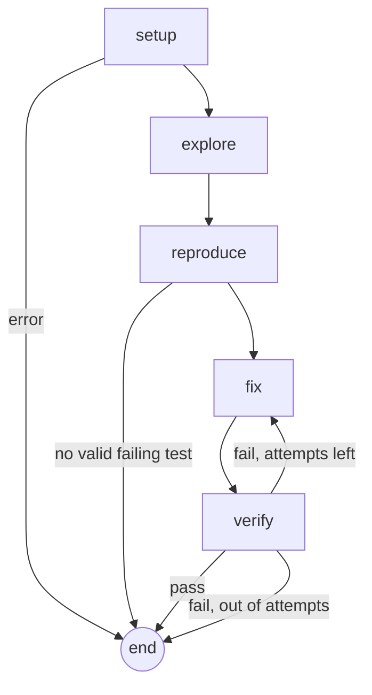

# RepoDoctor

**An autonomous agent that reads a GitHub issue, writes a failing test that reproduces it, fixes the code inside a locked-down Docker sandbox, and proves the fix against the project's own test suite.**

Built with [LangGraph](https://langchain-ai.github.io/langgraph/) and [LangChain](https://python.langchain.com/), traced with [LangSmith](https://smith.langchain.com/), and run on NVIDIA Nemotron models.

> **Status: early-stage research project.** The fix loop and the evaluation harness work end to end. The agent does **not** open pull requests yet, and nothing it produces is ever pushed anywhere. See [Status and roadmap](#status-and-roadmap).

---

## Contents

- [What it does](#what-it-does)
- [Design goals](#design-goals)
- [How it works](#how-it-works)
- [Safety model](#safety-model)
- [Setup (Windows)](#setup-windows)
- [Configuration reference](#configuration-reference)
- [Usage](#usage)
- [Evaluation](#evaluation)
- [Project layout](#project-layout)
- [Development](#development)
- [Troubleshooting](#troubleshooting)
- [Responsible use](#responsible-use)
- [Status and roadmap](#status-and-roadmap)
- [License](#license)

---

## What it does

Give it an issue. It does the following:

1. **Sets up** the repository in a Docker sandbox and records which tests already fail (the *baseline*).
2. **Explores** the code with read-only search tools to find the files responsible.
3. **Reproduces** the bug by writing a new pytest test, and only accepts it if it fails *for the right reason* on the unmodified code.
4. **Fixes** the bug by proposing exact search/replace edits.
5. **Verifies** the result: the new test must pass, and no test that passed before may fail now. If verification fails, the failure output goes back to the fixer for another attempt.

Example run on a real, closed issue in [`python-humanize/humanize`](https://github.com/python-humanize/humanize), replayed on the code as it was before the maintainers' fix:

```text
> uv run repodoctor fix-issue https://github.com/python-humanize/humanize/issues/154 --replay --fix-pr 169
Issue:    naturaldelta failing with float input and sub-second precision [closed]
Replay:   code as of c8a8d330d3, before the fix in PR #169

Relevant files: src/humanize/time.py
Hypothesis:     value = int(value) truncates 0.5 to 0, so the sub-second part is lost ...
Generated test: tests/test_repodoctor_repro.py::test_naturaldelta_float_subsecond_milliseconds
                (accepted on attempt 1)
Fix attempts:   1/3

--- a/src/humanize/time.py
+++ b/src/humanize/time.py
@@ -131,8 +131,7 @@ def naturaldelta(
-            value = int(value)
-            delta = dt.timedelta(seconds=value)
+            delta = dt.timedelta(seconds=float(value))

RESULT: SUCCESS (nothing was pushed; the diff above is the change)
Compare with the real fix: https://github.com/python-humanize/humanize/pull/169
```

---

## Design goals

- **Evidence over confidence.** A fix only counts if a test that failed for the right reason now passes and nothing regressed. The model's opinion of its own work is never the success signal.
- **Measured, not demoed.** A SWE-bench-style harness grades the agent with the *maintainers'* tests, which the agent never sees. See [Evaluation](#evaluation).
- **Safe by construction.** Repository allowlist, sandboxed execution, read-only agent tools, dry-run by default, and untrusted-input handling for issue text.
- **Cheap to run.** Free-tier models, small steps, short prompts. Every model is a config value.
- **Small and testable.** Deterministic tools are separate from LLM nodes, and the graph is only wiring. The nodes can be tested with fake models and a fake sandbox.

---

## How it works



| Node | Uses an LLM | What it does |
|---|---|---|
| `setup` | no | Installs dependencies in the sandbox (network on), cuts the network, runs the full test suite to record the **baseline**, and notes the starting commit. |
| `explore` | yes (tool calling) | A bounded loop with four read-only tools (`grep_code`, `find_definition`, `read_file`, `list_dir`). Ends with a structured answer: relevant files and a root-cause hypothesis. |
| `reproduce` | yes (structured output) | Writes one new test file, then **validates it in the sandbox**. Up to 3 tries, with the rejection reason fed back each time. Skipped if you pass `--test`. |
| `fix` | yes (structured output) | Resets the tree, then proposes `old`/`new` edits from the full text of the relevant files plus the history of failed attempts. |
| `verify` | no | Runs the target test, then the full suite, and compares it against the baseline. |

### Design decisions worth knowing

- **Search/replace edits, not diffs.** Models often produce broken diff hunks. Each edit carries the exact `old` text, which must occur **exactly once** in the file. Edits are applied atomically (all or nothing), tolerate CRLF files, reject path traversal and `.git`, and failures come back to the model as readable messages. The real diff is then generated by `git`.
- **Baseline comparison.** Real projects have tests that already fail (for example, a plugin incompatible with the newest pytest). "Exit code 0" is the wrong success test, so the agent ignores pre-existing failures and rejects only *new* ones.
- **The reproduction gate.** A generated test is rejected if it has a syntax error, passes on the unmodified code, times out, errors during collection, or fails with `ImportError`, `NameError` and similar. If no valid test comes out after the allowed tries, the run **stops before attempting any fix**.
- **Protected tests.** The agent cannot edit the target test files, so it cannot "fix" a bug by weakening the test.
- **Clean retries.** Before every attempt the working tree is reset to the last commit, but build artifacts created by the install step are preserved. The generated reproduction test is committed in the *local* work clone, so it survives resets.
- **Replay mode.** For a closed issue, the agent runs on the repository **as it was just before the fixing PR** (the base commit). The agent never sees the PR.
- **Model fallbacks.** Each role has a primary model and optional fallbacks. Tools and schemas are bound to every model *before* chaining, so a fallback behaves identically.
- **Untrusted text.** Issue text is wrapped in `<issue>` tags that it cannot close, and every prompt tells the model to treat it as data, not instructions.

---

## Safety model

| Risk | Mitigation |
|---|---|
| Running code from a repository | Everything runs in a Docker container: dropped Linux capabilities, `no-new-privileges`, memory, CPU and process limits, a hard timeout on every command, and only the cloned repo mounted. |
| Exfiltration or network abuse | The network is **disconnected after dependency install**, so tests run offline. |
| Agent touches the wrong repo | `ALLOWED_REPOS` allowlist, enforced before any clone. |
| Agent edits your original files | It works on a fresh clone in `.repodoctor/work/`. |
| Prompt injection via issue text | Delimited untrusted input, a read-only tool set, no secrets in the sandbox or the prompts. |
| Cheating by editing tests | Target test files are protected. At grading time the maintainers' test files are copied over the agent's. |
| Accidentally pushing something | There is no push code yet. `DRY_RUN=true` is the default, and it will remain the default when the PR step lands. |
| Runaway cost | Hard caps on attempts, explorer steps and context size. |

**Limitations you should understand:**

- The **dependency install step runs with the network on and executes the repository's build scripts.** Only allowlist repositories you are willing to execute code from.
- Docker is a strong boundary but not a perfect one. Do not point this at repositories you do not trust.
- Contribution policies of third-party projects (including rules about AI-generated contributions) are your responsibility. The tool scans for mentions and prints warnings, but it cannot interpret them. See [Responsible use](#responsible-use).

---

## Setup (Windows)

Developed and tested on Windows 11 with PowerShell. The code is cross-platform Python, but I have not tested Linux or macOS.

### 1. Prerequisites

```powershell
winget install --id=astral-sh.uv -e
winget install --id=Git.Git -e
winget install --id=Docker.DockerDesktop -e
winget install --id=BurntSushi.ripgrep.MSVC -e   # optional (the agent uses `git grep`)

git config --global core.autocrlf input    # keep LF: exact-match patching depends on it
git config --global core.longpaths true
```

Open a **new** terminal afterwards (the PATH only refreshes in new windows), and start Docker Desktop once so its first-run setup (WSL 2) completes.

### 2. Get the code

```powershell
git clone https://github.com/princ0301/RepoDoctor.git
cd RepoDoctor
uv sync
```

### 3. API keys

| Key | Where | Required | Notes |
|---|---|---|---|
| `NVIDIA_API_KEY` | [build.nvidia.com](https://build.nvidia.com) (starts with `nvapi-`) | recommended | Free credits, no card. Check your balance after a few runs. |
| `OPENROUTER_API_KEY` | [openrouter.ai](https://openrouter.ai) | recommended | Free `:free` models, tightly rate limited. Good as a fallback. |
| `GITHUB_TOKEN` | GitHub, Settings, Developer settings | optional | Today it only raises the API limit (60 to 5,000 requests per hour). Create a token with **no scopes**. A `public_repo` token is only needed once the PR step exists. |
| `LANGSMITH_API_KEY` | [smith.langchain.com](https://smith.langchain.com) | optional | Traces for every run. The free plan has a monthly trace limit and short retention, so check current terms. |

At least one of the NVIDIA or OpenRouter keys is needed.

### 4. Configure

Copy `.env.example` to `.env` and fill it in (no quotes, no spaces around `=`; `.env` is git-ignored):

```ini
# --- Keys ---
NVIDIA_API_KEY=
OPENROUTER_API_KEY=
GITHUB_TOKEN=
GITHUB_USERNAME=

# --- Safety ---
ALLOWED_REPOS=python-humanize/humanize,pallets/click,andialbrecht/sqlparse,prettytable/prettytable
DRY_RUN=true

# --- Models: provider:model, provider is "nvidia" or "openrouter" ---
LLM_EXPLORE=nvidia:nvidia/nemotron-3.5-lightning-30b-a3b
LLM_FIX=nvidia:nvidia/nemotron-3.5-super-vl-120b-a12b
LLM_FALLBACKS=openrouter:nvidia/nemotron-3.5-super-vl:free

# --- LangSmith (optional) ---
LANGSMITH_TRACING=true
LANGSMITH_API_KEY=
LANGSMITH_PROJECT=repodoctor-dev
```

### 5. Check everything

```powershell
uv run repodoctor doctor        # tools, keys, allowlist, selected models
uv run repodoctor check-llm     # live test of every configured model
```

`check-llm` verifies, for each model, that **tool calling** and **structured output** work. A model appearing in `nvidia-models` does not guarantee it can be called (some listed IDs return 404 on a given key), so trust `check-llm`.

---

## Configuration reference

All settings are environment variables (read from `.env`).

| Variable | Default | Meaning |
|---|---|---|
| `NVIDIA_API_KEY`, `OPENROUTER_API_KEY` | empty | Provider credentials |
| `GITHUB_TOKEN`, `GITHUB_USERNAME` | empty | GitHub API access |
| `ALLOWED_REPOS` | empty | Comma-separated `owner/repo` list the agent may work on |
| `DRY_RUN` | `true` | Reserved for the PR step: never push or open a PR |
| `LLM_EXPLORE` | `openrouter:nvidia/nemotron-3.5-super-vl:free` | Model for the explorer (many small calls, wants speed) |
| `LLM_FIX` | `openrouter:nvidia/nemotron-3.5-super-vl:free` | Model for the fixer and the test writer (few calls, wants quality) |
| `LLM_FALLBACKS` | empty | Comma-separated models tried if the primary fails |
| `LLM_TIMEOUT_S` | `120` | Per-request timeout |
| `MAX_ATTEMPTS` | `3` | Fix/verify tries per run |
| `REPRO_MAX_ATTEMPTS` | `3` | Tries to produce a valid reproduction test |
| `EXPLORE_MAX_STEPS` | `10` | Tool-calling rounds in the explorer |
| `FIX_CONTEXT_CHARS` | `80000` | Budget for source files shown to the fixer |
| `SANDBOX_TIMEOUT_S` | `300` | Time limit per test run |
| `SANDBOX_MEMORY`, `SANDBOX_CPUS` | `2g`, `2.0` | Container limits |
| `WORK_DIR` | `.repodoctor/work` | Where repositories are cloned |

To add a model, put `provider:model-id` in `LLM_*` and run `check-llm`. To add an OpenAI-compatible provider, add one entry to `ENDPOINTS` in `src/repodoctor/models.py`.

---

## Usage

### Quick start: a seeded bug

```powershell
uv run repodoctor make-demo
```

This creates two tiny repositories with the same bug, and prints a ready-to-run command for each:

1. `textkit`: a failing test for the bug already exists (you pass it with `--test`).
2. `textkit-blind`: no test exists, so the agent has to write one itself.

The first run builds the sandbox image, which takes a few minutes.

### A real GitHub issue

```powershell
# An open issue (the repository must be in ALLOWED_REPOS)
uv run repodoctor fix-issue https://github.com/OWNER/REPO/issues/123

# A closed issue: run on the code as it was before the merged fix
uv run repodoctor fix-issue https://github.com/OWNER/REPO/issues/123 --replay

# If the fixing PR is not detected automatically
uv run repodoctor fix-issue https://github.com/OWNER/REPO/issues/123 --replay --fix-pr 456

# Supply your own failing test instead of generating one
uv run repodoctor fix-issue URL --test tests/test_x.py::test_bug
```

`fix-issue` also warns if the issue is already assigned, and prints any lines in the project's contribution docs that mention AI.

### A local repository

```powershell
uv run repodoctor fix --repo-dir PATH --issue-file ISSUE.md [--test TEST_ID]
```
The repository must be a committed git repo. The first line of the issue file is the title. Your original is never modified.

### All commands

| Command | Purpose |
|---|---|
| `doctor` | Check tools, keys, allowlist and selected models |
| `check-llm` | Live-test every configured model (tool calling and structured output) |
| `nvidia-models` | List model IDs your NVIDIA key can see |
| `check-issue URL` | Validate an issue URL against the allowlist |
| `inspect URL` | Clone a repo and detect how to test it |
| `smoke URL` | Run a repo's own tests in the sandbox and report the baseline |
| `make-demo` | Create the seeded-bug demo repositories |
| `fix`, `fix-issue` | Run the agent (local repo or GitHub issue) |
| `eval-discover`, `eval-build`, `eval-run`, `eval-report` | The [evaluation harness](#evaluation) |
| `hello` | Wiring check for the LangGraph and LangSmith setup |

Every run is traced to LangSmith (when enabled) under a run name such as `fix:owner/repo#123`. Open the trace to see each explorer tool call, the exact prompt the fixer received, and the sandbox results.

---

## Evaluation

A demo that works once proves little: the same issue can take 3 attempts one time and 1 the next. The harness measures the agent the way [SWE-bench](https://www.swebench.com/) does, using real issues whose fixes are known.

### How a case is built and graded

Each case is a real closed issue with one merged fixing PR, built by `eval-build`:

1. Take the repository at the PR's **base commit**.
2. Copy in the **maintainers' test files** from the PR and run them: tests that **fail** are candidate *fail-to-pass* tests.
3. Run the same tests on the PR's own tree: tests that **pass** there confirm the ground truth.
   - **fail-to-pass (FTP):** failed before, pass after the real fix.
   - **pass-to-pass (PTP):** passed both times (must not break).
4. Reject the case if no test is fail-to-pass, if the install fails, or if the PR is too large (more than 4 source files).

An agent run is graded after it finishes: the maintainers' test files are copied over the agent's final tree (so it cannot have weakened them), and the run is **resolved** only if **every FTP and PTP test passes**. The agent's own reproduction test plays no part in grading.

### Outcomes

| Outcome | Meaning |
|---|---|
| `resolved` | The agent's fix passes the maintainers' tests |
| `wrong_fix` | The agent reported success but the maintainers' tests fail (overconfidence) |
| `fix_failed` | The retry budget ran out without a passing fix |
| `no_repro` | No valid failing test could be produced, so no fix was attempted |
| `explore_failed`, `model_error`, `setup_error`, `crash` | Infrastructure or model failures, not reasoning failures |

Reported metrics: **resolve rate**, **precision** (resolved divided by "agent said success"), **solved in at least one trial** (pass@k, when `--trials` is above 1), attempts, and time.

### Running it

```powershell
# 1. Find candidate (issue, fixing PR) pairs from merged PRs that say "Fixes #N"
uv run repodoctor eval-discover owner/repo --limit 8 --max-prs 300

# 2. Validate them and compute ground truth (resumable, remembers rejections)
uv run repodoctor eval-build

# 3. Run the agent
uv run repodoctor eval-run --split dev --label my-experiment
uv run repodoctor eval-run --split heldout --trials 3 --label baseline

# 4. Inspect results (diff, per-attempt history, link to the maintainers' fix)
uv run repodoctor eval-report .repodoctor\evals\<run>\results.jsonl --show CASE_ID
```

Other `eval-run` options: `--only CASE_ID`, `--limit N`, `--per-repo N`, `--trials N`. Results go to `.repodoctor/evals/<timestamp>-<label>/` (`results.jsonl` and `meta.json`). Each run is tagged in LangSmith with `eval`, `eval:<label>`, `case:<id>` and `trial:<n>`.

Files: `evals/specs.json` (the issue/PR pairs), `evals/cases.json` (validated cases with ground truth), `evals/dev_ids.txt` (the dev split).

### Dev and held-out splits

To avoid fooling yourself, tune prompts and settings on the **dev** cases (listed in `evals/dev_ids.txt`), and measure on the **held-out** cases only after a change is final. Measuring on the cases you tuned on inflates the result.

### Dataset

The current dataset has 31 validated cases from four pure-Python repositories (`python-humanize/humanize`, `pallets/click`, `andialbrecht/sqlparse`, `prettytable/prettytable`). Cases were chosen by a script and not hand-picked, and the build step rejected the ones whose tests could not give reliable ground truth.

### Preliminary results

These are **early numbers from a very small sample and should not be quoted as the agent's performance.** Dev set (7 cases), one trial each, run on 2026-11-01 with `nemotron-3.5-lightning-30b-a3b` for exploring and `nemotron-3.5-super-vl-120b-a12b` for fixing:

| Case | Outcome | Fix attempts |
|---|---|---|
| humanize #154 | resolved | 1 |
| humanize #122 | resolved | 1 |
| humanize #62 | wrong_fix | 1 |
| humanize #24 | resolved | 1 |
| click #3084 | fix_failed | 3 |
| sqlparse #632 | resolved | 2 |
| prettytable #398 | wrong_fix | 2 |

Resolved 4 of 7, with precision 67% (4 of the 6 reported successes). The held-out baseline (31 minus 7 dev cases, 3 trials) has not been run yet.

### Caveats about the numbers

- **The sample is small and runs are noisy.** The same issue (humanize #154) needed 3 attempts in one run and 1 in another.
- **The grader is strict.** It checks the exact behavior the maintainers' tests encode, so a reasonable alternative fix can be marked wrong. Review `wrong_fix` cases by hand before drawing conclusions.
- **Possible memorization.** Older public issues may be partly memorized by the models. Newer cases are less likely to be.
- **Not comparable to leaderboards.** SWE-bench scores depend on the whole agent scaffold and the model, and these numbers use a different scaffold and free models. Compare results from this harness only with each other.

---

## Project layout

```text
src/repodoctor/
  cli.py            Typer CLI (all commands)
  config.py         Settings (pydantic-settings, read from .env)
  models.py         "provider:model" -> chat model, fallbacks, diagnostics
  state.py          Graph state (JSON-friendly types only)
  schemas.py        Pydantic outputs: Edit, ExploreResult, FixProposal, ReproTest
  deps.py           Everything nodes need, injected once (sandbox, models, tools)
  graph.py          Wiring only: nodes and conditional edges
  runner.py         Workspace, sandbox, models, graph; local and GitHub modes
  demo.py           Seeded-bug demo repositories
  tracing.py        LangSmith run configuration
  nodes/            setup, explore, reproduce, fix, verify, search_tools, util
  tools/            Deterministic code, no LLM:
                      issue_ref   parse issue URLs, allowlist
                      repo        git clone/diff/reset/checkout, project detection
                      patch       atomic search/replace editing
                      paths       safe path resolution
                      search      grep, find_symbol, read_file, list_dir
                      sandbox     Docker lifecycle and test execution
                      testreport  JUnit XML parsing, baseline comparison
                      github      read-only REST access (issues, PRs, files)
                      policy      scan contribution docs for AI mentions
  prompts/          explore.md, fix.md, reproduce.md
  evals/            discover, build, grade, run (the evaluation harness)
docker/             sandbox.Dockerfile
evals/              specs.json, cases.json, dev_ids.txt (evaluation data)
tests/              unit/, graph/, integration/ (Docker)
```

Layering rule: `tools/` never imports an LLM library, `nodes/` combine prompts, models and tools, and `graph.py` contains no logic.

---

## Development

```powershell
uv run pytest -q -m "not docker"    # fast: unit tests plus graph tests with fake LLMs and sandbox
uv run pytest -q -m docker          # needs Docker; builds the sandbox image on first run
uv run ruff check . --fix
```

- **Graph tests** run the real graph with scripted fake models and a fake sandbox, but with real git, so routing, retry, patching and reset logic are covered without API calls.
- **Docker tests** cover the sandbox itself: timeouts, network lockdown, file sharing and cleanup.
- Pytest markers: `slow` (end-to-end), `docker` (needs a running daemon).
- To add a node, write `make_<name>(deps)` in `nodes/`, register it in `graph.py`, and add a graph test.

---

## Troubleshooting

| Symptom | Fix |
|---|---|
| `uv` or `rg` "not recognized" after installing | Open a new terminal. If it persists, refresh the PATH or restart your editor. |
| Docker commands hang or fail | Start Docker Desktop. If it complains about WSL 2, run `wsl --install` in an admin PowerShell and reboot. |
| `check-llm`: `404 model not found` | A listed model is not necessarily callable with your key. Use one that passes `check-llm`. |
| `check-llm`: `429` | Free-tier rate limit. Wait, or use a different model for that role. |
| `not in ALLOWED_REPOS` | Add `owner/repo` to `ALLOWED_REPOS` in `.env`. |
| `GitHub refused the request ... rate limited` | Set `GITHUB_TOKEN` (a no-scope token is enough). |
| `no merged pull request found for this issue` | Pass `--fix-pr NUMBER` (the issue page shows "Fixed by #N"). |
| `The target test(s) already pass` | The test does not reproduce the bug on the code at that commit. |
| `unsupported project` | Only Python projects tested with pytest are supported. |
| Baseline shows pre-existing errors | Normal. They are recorded and ignored (for example, a plugin that does not work with the latest pytest). |
| Typing `<url>` in PowerShell fails | PowerShell treats `<` as redirection. Use a real URL, with no angle brackets. |
| `The system cannot find the path` while cloning | Keep the project at a short path such as `C:\dev\repodoctor`. |

---

## Responsible use

- Unsolicited AI-generated pull requests are a real burden on maintainers, and many projects have policies about them. **Read a project's `CONTRIBUTING` file and any AI policy before contributing.**
- A human must review everything. You are responsible for any contribution you make and for answering the maintainers' comments.
- Disclose AI assistance, keep changes small, and prefer issues that invite contributions.
- The allowlist and `DRY_RUN` default exist to keep you in control. Do not weaken them.
- Replaying historical issues (as the evaluation does) reads public repositories and contributes nothing to them.

---

## Status and roadmap

| | |
|---|---|
| **Working** | Sandbox, patching, search tools, explore/reproduce/fix/verify loop, model fallbacks, GitHub issue intake with replay, evaluation harness, LangSmith tracing |
| **Not built yet** | Triage gate (skip assigned, already-fixed or non-actionable issues), lint/format check of the diff, human approval step, fork-push-PR flow, checkpointing and resume, issue-to-PR detection via GitHub's GraphQL "closed by" data |
| **Supported** | Python repositories tested with pytest |
| **Next** | Diagnose failures from the dev baseline; run the held-out baseline; improve the weakest stage; then the approval step and a dry-run-first PR flow |

<!-- Known limitations:
- Only Python and pytest.
- Free-tier model quotas limit how many evaluation runs are practical.
- No retrieval or embeddings: the agent uses text search and file reading. They will be added only if the evaluation shows retrieval is the bottleneck.
- Repository setup is generic (`pip install -e .[tests]`, requirement files, dependency groups). Projects with unusual setups are rejected rather than guessed.

---

## License

No license has been chosen yet. Add a `LICENSE` file before publishing or accepting contributions. -->