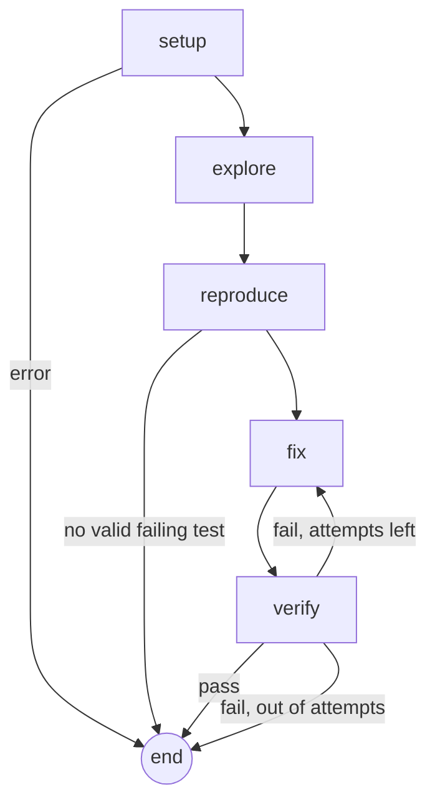
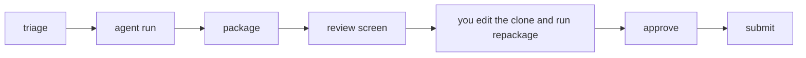

# RepoDoctor

**An agent that reads a GitHub issue, writes a failing test that reproduces it, fixes the code inside a locked-down Docker sandbox, and checks the fix against the project's own test suite. A separate, guarded pipeline can turn a successful run into a pull-request package that a human reviews, edits and approves before anything is sent.**

Built with [LangGraph](https://langchain-ai.github.io/langgraph/) and [LangChain](https://python.langchain.com/), traced with [LangSmith](https://smith.langchain.com/), and run on free NVIDIA Nemotron models.

> **Status: research prototype.** The fix loop, the evaluation harness and the pull-request pipeline work end to end. The pipeline is built to say no: it refuses projects that have ended or reject AI contributions, and it never sends anything without an explicit human approval and `DRY_RUN=false`. Measured resolve rates are in [Results](#results), together with the reasons not to over-read them.

---

## Contents

- [What it does](#what-it-does)
- [Design goals](#design-goals)
- [How it works](#how-it-works)
- [From a successful run to a pull request](#from-a-successful-run-to-a-pull-request)
- [Safety model](#safety-model)
- [Setup (Windows)](#setup-windows)
- [Configuration reference](#configuration-reference)
- [Usage](#usage)
- [Evaluation method](#evaluation-method)
- [Results](#results)
- [Project layout](#project-layout)
- [Development](#development)
- [Troubleshooting](#troubleshooting)
- [Responsible use](#responsible-use)
- [Status and roadmap](#status-and-roadmap)
- [License](#license)

---

## What it does

**Part 1: fix an issue.** Give it an issue. It does the following:

1. **Sets up** the repository in a Docker sandbox and records which tests already fail (the *baseline*).
2. **Explores** the code with read-only search tools and names the files most likely involved.
3. **Reproduces** the bug by writing a new pytest test, and accepts it only if it fails *for the right reason* on the unmodified code.
4. **Fixes** the bug by proposing exact search/replace edits. If it needs another file it can ask for one without spending an attempt.
5. **Verifies**: the new test must pass, and no test that passed before may fail now. If verification fails, the failure output goes back to the fixer for another attempt (three at most).

**Part 2: prepare a pull request (optional, human in the loop).** Before the run it checks whether the issue and the project are reasonable targets. After a successful run it builds a package: one clean commit, the patch, a PR description in the project's own template, hints about its conventions, and a review screen. You edit, re-verify, write the root cause in your own words, and approve. Only then can `submit` open the pull request.

Example, on a real closed issue in [`python-humanize/humanize`](https://github.com/python-humanize/humanize), replayed on the code as it was before the maintainers' fix:

```text
> uv run repodoctor fix-issue https://github.com/python-humanize/humanize/issues/154 --replay --fix-pr 169
Issue:    naturaldelta failing with float input and sub-second precision [closed]
Replay:   code as of c8a8d330d3, before the fix in PR #169

Relevant files: src/humanize/time.py
Hypothesis:     value = int(value) truncates 0.5 to 0, so the sub-second part is lost ...
Generated test: tests/test_repodoctor_repro.py::test_naturaldelta_float_subsecond_milliseconds
                (accepted on attempt 1)
Fix attempts:   1/3

--- a/src/humanize/time.py
+++ b/src/humanize/time.py
@@ -131,8 +131,7 @@ def naturaldelta(
-            value = int(value)
-            delta = dt.timedelta(seconds=value)
+            delta = dt.timedelta(seconds=float(value))

RESULT: SUCCESS (nothing was pushed; the diff above is the change)
Compare with the real fix: https://github.com/python-humanize/humanize/pull/169
```

---

## Design goals

- **Evidence over confidence.** A fix counts only if a test that failed for the right reason now passes and nothing regressed. The model's opinion of its own work is never the success signal.
- **Measured, not demoed.** A SWE-bench-style harness grades the agent with the *maintainers'* tests, which the agent never sees. See [Evaluation method](#evaluation-method).
- **Honest numbers.** Rules for counting results are written before runs, deviations are recorded, and cases are reviewed for fairness from the issue text alone.
- **Safe by construction.** Repository allowlist, sandboxed execution, read-only agent tools, dry-run by default, and untrusted-input handling for issue text.
- **Respectful of maintainers.** Triage refuses projects that have ended or that turn AI contributions away, the human writes the root cause, disclosure is built in, and nothing is sent without approval. See [Responsible use](#responsible-use).
- **Cheap to run.** Free-tier models, small steps. Every model is a config value.
- **Small and testable.** Deterministic tools are separate from LLM nodes, and the graph is only wiring. Nodes can be tested with fake models and a fake sandbox.

---

## How it works



| Node | LLM | What it does |
|---|---|---|
| `setup` | no | Installs dependencies (network on), cuts the network, runs the full test suite to record the **baseline**, notes the starting commit. |
| `explore` | yes (tools) | A bounded loop with four read-only tools (`grep_code`, `find_definition`, `read_file`, `list_dir`), then a structured answer: relevant files and a root-cause hypothesis. Paths that do not exist get one correction round. |
| `reproduce` | yes (structured) | Writes one new test file and **validates it in the sandbox**. Up to 3 tries, with the rejection reason fed back. Skipped if you pass `--test`. |
| `fix` | yes (structured) | Resets the tree, then proposes `old`/`new` edits from the full text of the relevant files and the history of failed attempts. May request more files (`need_more_files`); up to `FIX_CONTEXT_ROUNDS` such requests are answered **within the same attempt**. |
| `verify` | no | Runs the target test, then the full suite, and compares it with the baseline. |

### Design decisions worth knowing

- **Search/replace edits, not diffs.** Each edit carries the exact `old` text, which must occur exactly once. Edits apply atomically, tolerate CRLF files, reject path traversal and `.git`, and failures come back to the model as readable messages. The real diff is then generated by `git`.
- **Baseline comparison.** Real projects have tests that already fail. The agent ignores pre-existing failures and rejects only *new* ones.
- **The reproduction gate.** A generated test is rejected if it has a syntax error, passes on the unmodified code, times out, errors during collection, or fails with `ImportError`, `NameError` and similar. If no valid test comes out, the run **stops before attempting any fix**.
- **Protected tests.** The agent cannot edit the target test files. Updating *other* existing tests is off by default (`ALLOW_TEST_UPDATES`).
- **Clean retries.** Before every attempt the tree is reset to the last commit; build artifacts from the install step survive.
- **Replay mode.** For a closed issue, the agent runs on the repository **as it was just before the fixing PR**. It never sees the PR.
- **Resilient model calls.** Each model has a hard wall-clock deadline, fallbacks are tried in order, and malformed or empty structured output counts as a failed attempt, not a crash.
- **Untrusted text.** Issue text is wrapped in tags it cannot close, and every prompt says to treat it as data.
- **Per-project overrides.** `evals/repo_overrides.json` lists test files that hang in the sandbox, flags that distort a project's own tests, and extra arguments such as pytest-xdist workers.
- **Version-from-git projects.** Projects that read their version from git tags (setuptools-scm) are installed with a version computed from `git describe`, because a sandbox clone has no tags.

---

## From a successful run to a pull request



| Stage | Command | What it does |
|---|---|---|
| Choose | `triage-repo`, `triage-scan`, `triage` | GitHub API only, no model calls. Checks the **project** (ended or inactive? restricts or rejects AI contributions? threads about AI?) and the **issue** (closed, assigned, claimed in a comment, linked open PR, labels, code sample). Verdicts: ok, warn, skip. |
| Learn | `conventions` | Reads a project's recent merged bug-fix PRs: where tests go, how tests are named, how the changelog is kept, the PR template, typical size. |
| Run and package | `fix-issue --prepare-pr` | Runs triage, the agent, then writes a package under `.repodoctor/prs/`: `change.patch`, `pr.md`, `package.json`, and `clone/` (its own copy of the work tree with **one commit** on branch `repodoctor/issue-N`). |
| Review | printed automatically, or `review` | Triage, policy lines, project conventions, diff checks, evidence, the agent's hypothesis (marked unverified), the PR text, the patch. |
| Edit and verify | `repackage` | You edit files in `clone/` (move the test to where the project keeps tests, write the changelog entry). `repackage` folds the edits into the commit, then re-verifies in the sandbox: the test fails without the source change, passes with it, nothing newly fails, and the project's own linters (from its pre-commit config) report nothing on the lines you added. It ticks the PR checklist boxes it verified, and clears any earlier approval. |
| Approve | typed in `review` | You type the repository name. Approval records hashes of the patch and `pr.md`; any later edit invalidates it. It also needs: no blocking finding, a root cause you wrote (at least 8 words, no `TODO(reviewer)` left in `pr.md` or the patch), and an acknowledgement if the project's docs or threads mention AI. |
| Send | `submit` | Fork (unless you own the repository), push, open the pull request. See the guards below. |

What the package contains for you to finish by hand: the **root cause** (left as a `TODO(reviewer)` line; the agent's own hypothesis is shown but never posted), a **changelog entry** (an empty fragment file for projects that use fragments, or a suggested line in the existing changelog's style), and the **test's home**, since almost no real project adds a new test file per issue.

---

## Safety model

| Risk | Mitigation |
|---|---|
| Running code from a repository | Docker container with dropped capabilities, `no-new-privileges`, memory, CPU and process limits, a hard timeout on every command, and only the cloned repo mounted. |
| Network abuse | The network is **disconnected after dependency install**, so tests run offline. |
| Agent touches the wrong repo | `ALLOWED_REPOS` allowlist, enforced before any clone. |
| Agent edits your files | It works on a fresh clone in `.repodoctor/work/`. |
| Prompt injection via issue text | Delimited untrusted input, read-only tools, no secrets in the sandbox or prompts. |
| Cheating by editing tests | Target tests are protected. At grading time the maintainers' test files overwrite the agent's. |
| Contributing where it is unwelcome | Triage skips ended, archived, inactive-with-notice and AI-rejecting projects, and warns about AI policies. |
| Secrets or CI changes in a patch | Diff checks block secrets, edits to CI configuration, and empty patches. |
| Sending something unreviewed | `submit` needs every guard below. |
| Runaway cost or time | Hard caps on attempts, explorer steps, context size, per-call deadline and per-run time. |

**`submit` refuses unless all of these hold:**

| Guard | Detail |
|---|---|
| `DRY_RUN=false` | Otherwise it prints the plan and stops. |
| Approved and unchanged | The hashes of `pr.md` and the patch match, no blocking finding exists, the work clone has no uncommitted changes, its commit equals the approved one, and regenerating the patch gives identical text. |
| Allowlist | The repository must be in `ALLOWED_REPOS`. |
| Fresh triage | Run again just before sending; `skip` blocks it. There is no bypass flag. |
| Right account | The push token must belong to `GITHUB_USERNAME`. |
| Rate limit | At most `MAX_PRS_PER_DAY` (default 1) per 24 hours, kept in `.repodoctor/prs/ledger.json`. |
| No repeats | A package that opened a PR cannot be submitted again; an interrupted run resumes without duplicating. |
| Typed confirmation | You type `SUBMIT`; there is no `--yes`. |

The push token (`GITHUB_PUSH_TOKEN`) is separate from the read token, is read only by `submit`, and travels in a transient HTTP header: never stored in the clone's git config and scrubbed from error messages. Use a **fine-grained token limited to one repository** with a short expiry. Opening a PR on a repository you do not own needs a classic token with only `public_repo`, because fine-grained tokens cannot do that.

**Limitations you should understand:**

- The **dependency install step runs with the network on and executes the repository's build scripts.** Only allowlist repositories you are willing to execute code from.
- A **pip cache volume is shared between sandbox containers** to speed up installs, so a malicious build script could poison it. Reset it with `docker volume rm repodoctor-pip-cache`.
- Docker is a strong boundary but not a perfect one. Do not point this at repositories you do not trust.
- Triage is a set of heuristics over titles, labels and a few files. A project that says nothing about AI is not thereby welcoming it. Read the project's contributing guide yourself.
- The fork route of `submit` is tested only against a mocked GitHub API; exercise it on your own repository first.

---

## Setup (Windows)

Developed and tested on Windows 11 with PowerShell. The code is cross-platform Python, but I have not tested Linux or macOS.

### 1. Prerequisites

```powershell
winget install --id=astral-sh.uv -e
winget install --id=Git.Git -e
winget install --id=Docker.DockerDesktop -e
winget install --id=BurntSushi.ripgrep.MSVC -e   # optional (the agent uses `git grep`)

git config --global core.autocrlf input    # keep LF: exact-match patching depends on it
git config --global core.longpaths true
```

Open a **new** terminal afterwards (PATH changes only reach new windows) and start Docker Desktop once so its first-run setup (WSL 2) completes.

### 2. Get the code

```powershell
git clone https://github.com/princ0301/RepoDoctor.git
cd RepoDoctor
uv sync
```

### 3. API keys

| Key | Where | Required | Notes |
|---|---|---|---|
| `NVIDIA_API_KEY` | [build.nvidia.com](https://build.nvidia.com) (starts `nvapi-`) | recommended | Free credits. |
| `OPENROUTER_API_KEY` | [openrouter.ai](https://openrouter.ai) | recommended | Free `:free` models, tightly rate limited. Good as a fallback. |
| `GITHUB_TOKEN` | GitHub, Settings, Developer settings | strongly recommended | Raises the API limit (60 to 5,000 per hour); triage and conventions make dozens of requests. Create a token with **no scopes**. |
| `GITHUB_PUSH_TOKEN` | same place | only for `submit` | Fine-grained, one repository, short expiry. |
| `LANGSMITH_API_KEY` | [smith.langchain.com](https://smith.langchain.com) | optional | Traces for every run. |

At least one of the NVIDIA or OpenRouter keys is needed.

### 4. Configure

Copy `.env.example` to `.env` (no quotes, no spaces around `=`; `.env` is git-ignored):

```ini
NVIDIA_API_KEY=
OPENROUTER_API_KEY=
GITHUB_TOKEN=
GITHUB_USERNAME=
GITHUB_PUSH_TOKEN=

ALLOWED_REPOS=python-humanize/humanize,pallets/click,andialbrecht/sqlparse,prettytable/prettytable
DRY_RUN=true

LLM_EXPLORE=nvidia:nvidia/nemotron-3.5-lightning-30b-a3b
LLM_FIX=nvidia:nvidia/nemotron-3.5-super-vl-120b-a12b
LLM_FALLBACKS=openrouter:nvidia/nemotron-3.5-super-vl:free

LANGSMITH_TRACING=true
LANGSMITH_API_KEY=
LANGSMITH_PROJECT=repodoctor-dev
```

### 5. Check everything

```powershell
uv run repodoctor doctor        # tools, keys, allowlist, selected models
uv run repodoctor check-llm     # live test of every configured model
```

`check-llm` verifies that **tool calling** and **structured output** work for each model. A model appearing in `nvidia-models` does not guarantee it can be called, so trust `check-llm`.

---

## Configuration reference

All settings are environment variables (read from `.env`).

| Variable | Default | Meaning |
|---|---|---|
| `NVIDIA_API_KEY`, `OPENROUTER_API_KEY` | empty | Provider credentials |
| `GITHUB_TOKEN`, `GITHUB_USERNAME` | empty | GitHub read access; your username (author of commits, owner check for `submit`) |
| `GITHUB_PUSH_TOKEN` | empty | Used only by `submit` |
| `ALLOWED_REPOS` | empty | Comma-separated `owner/repo` list the agent may work on |
| `DRY_RUN` | `true` | `submit` sends nothing unless this is `false` |
| `LLM_EXPLORE` / `LLM_FIX` | `openrouter:nvidia/nemotron-3.5-super-vl:free` | Models for exploring, and for the test writer and fixer |
| `LLM_FALLBACKS` | empty | Comma-separated models tried when the primary fails |
| `LLM_TIMEOUT_S`, `LLM_MAX_RETRIES` | `120`, `2` | Per-request client settings |
| `LLM_CALL_DEADLINE_S` | `240` | Hard wall-clock limit per model call; a timeout moves on to the fallback |
| `MAX_ATTEMPTS` | `3` | Fix/verify tries per run |
| `REPRO_MAX_ATTEMPTS` | `3` | Tries to produce a valid reproduction test |
| `EXPLORE_MAX_STEPS` | `10` | Tool-calling rounds in the explorer |
| `FIX_CONTEXT_CHARS` | `240000` | Budget for source files shown to the fixer |
| `FIX_CONTEXT_ROUNDS` | `2` | Free file requests per fix attempt (`0` restores the old behavior) |
| `ALLOW_TEST_UPDATES` | `false` | Let the fixer update an existing test that contradicts the issue |
| `RUN_TIMEOUT_S` | `900` | Checked between steps; `0` disables |
| `SANDBOX_TIMEOUT_S`, `SANDBOX_MEMORY`, `SANDBOX_CPUS` | `300`, `2g`, `2.0` | Per test run, and container limits |
| `BUILD_INSTALL_TIMEOUT_S`, `BUILD_STEP_TIMEOUT_S` | `300`, `240` | Limits used when building evaluation cases and installing linters |
| `PRS_DIR` | `.repodoctor/prs` | Where pull-request packages and the submission ledger live |
| `PR_MAX_DIFF_LINES`, `PR_MAX_FILES` | `300`, `8` | Size warnings for a patch |
| `GIT_AUTHOR_NAME`, `GIT_AUTHOR_EMAIL` | your username and its noreply address | Author of the commit in a package |
| `COMMIT_TRAILER` | `Assisted-by: RepoDoctor ({model})` | Disclosure line added to the commit and the PR text; empty switches it off (some projects forbid, or specify, a trailer: follow theirs) |
| `MAX_PRS_PER_DAY` | `1` | Limit enforced by `submit` |
| `CONVENTIONS_DIR` | `.repodoctor/conventions` | Cache (7 days) of what `conventions` learned |
| `WORK_DIR` | `.repodoctor/work` | Where repositories are cloned (safe to delete; packages keep their own clone) |

Models are `provider:model` with provider `nvidia` or `openrouter`. To add another OpenAI-compatible provider, add an entry to `ENDPOINTS` in `src/repodoctor/models.py`. Per-repository test overrides live in `evals/repo_overrides.json`.

---

## Usage

### Quick start: a seeded bug

```powershell
uv run repodoctor make-demo
```
This creates two tiny repositories with the same bug and prints a ready-to-run command for each: one with a failing test already in place (`--test`), and one where the agent has to write the test itself. The first run builds the sandbox image, which takes a few minutes.

### Choose a target

```powershell
uv run repodoctor triage-repo OWNER/REPO              # is this project a reasonable place to contribute?
uv run repodoctor triage-scan OWNER/REPO --limit 15   # open, unassigned issues, ranked; marks maintainer involvement
uv run repodoctor triage https://github.com/OWNER/REPO/issues/123
uv run repodoctor conventions OWNER/REPO              # how its merged fix PRs look
```

### A real GitHub issue

```powershell
uv run repodoctor fix-issue https://github.com/OWNER/REPO/issues/123               # open issue (runs triage first)
uv run repodoctor fix-issue https://github.com/OWNER/REPO/issues/123 --replay      # closed: code before the fix
uv run repodoctor fix-issue URL --replay --fix-pr 456                              # name the fixing PR yourself
uv run repodoctor fix-issue URL --test tests/test_x.py::test_bug                   # your own failing test
uv run repodoctor fix-issue URL --prepare-pr                                       # also write a PR package and review it
```
The repository must be in `ALLOWED_REPOS`. `--ignore-triage` runs the agent despite a skip verdict; it never bypasses `submit`.

### The pull-request flow

```powershell
uv run repodoctor fix-issue URL --prepare-pr                      # package + review screen
# edit files in .repodoctor\prs\OWNER__REPO-N\clone, then edit pr.md (the root cause is yours to write)
uv run repodoctor repackage .repodoctor\prs\OWNER__REPO-N [--test FILE::NAME]
uv run repodoctor review    .repodoctor\prs\OWNER__REPO-N         # review again, approve
uv run repodoctor submit    .repodoctor\prs\OWNER__REPO-N         # plan only while DRY_RUN=true
```
For a real submission set `DRY_RUN=false` for that session only (PowerShell: `$env:DRY_RUN = "false"`).

### A local repository

```powershell
uv run repodoctor fix --repo-dir PATH --issue-file ISSUE.md [--test TEST_ID]
```

### All commands

| Command | Purpose |
|---|---|
| `doctor`, `check-llm`, `nvidia-models` | Environment, model checks, model discovery |
| `check-issue`, `inspect`, `smoke` | Validate an issue URL; detect test setup; run a repo's tests in the sandbox (`--durations N`, `--per-file` to find hanging test files) |
| `make-demo`, `fix`, `fix-issue` | Run the agent |
| `triage`, `triage-scan`, `triage-repo`, `conventions` | Choose and understand a target (GitHub API only, no model calls) |
| `review`, `repackage`, `submit` | Review, re-verify, approve and send a pull-request package |
| `eval-discover`, `eval-build` | Find and validate evaluation cases |
| `eval-run`, `eval-report`, `eval-failures`, `eval-compare` | Run the agent on cases, inspect and compare results |
| `eval-inspect`, `eval-gold`, `eval-recheck` | Review cases for fairness (issue and PR text, the maintainers' tests, pairing checks) |

Every run is traced to LangSmith when enabled, under names like `fix:owner/repo#123`.

---

## Evaluation method

A demo that works once proves little: the same issue can take three attempts one time and one the next. The harness follows [SWE-bench](https://www.swebench.com/) and uses real issues whose fixes are known.

### How a case is built and graded

Each case is a closed issue with one merged fixing PR (`eval-build`):

1. Take the repository at the PR's **base commit**.
2. Apply the PR's test files and run them: tests that fail are *fail-to-pass* candidates.
3. Apply **only the files the PR changed** to the base tree and run the same tests.
   - **fail-to-pass:** failed before, pass after the real fix.
   - **pass-to-pass:** passed both times.
4. Reject the case if nothing is fail-to-pass, the install fails, a test run exceeds its limit, or the PR is too large.

After an agent run, the maintainers' test files are copied over the agent's tree, and the run is **resolved** only if **every fail-to-pass and pass-to-pass test passes**. The agent's own reproduction test plays no part in grading. Tests that exist only in the PR (new test functions, and renumbered parametrize ids) are flagged as possibly unseen by the agent; they are an upper bound, not an exact count.

### Fairness review

Many issue and PR pairs are not fair tests: the maintainers' tests may pin names or exact output that the issue never states. Every case is reviewed **from the issue, the PR text and the test code, never from how the agent performed**, and tagged in `evals/case_flags.txt`:

| Tag | Meaning | Effect |
|---|---|---|
| `[spec]` | The tests need something the issue does not state | Skipped |
| `[scope]` | The tests need the fix to generalize beyond the reported instance | Kept in the headline, reported separately |
| `[infra]` | The harness cannot run the case | Skipped |

### Splits and counting rules

- **Dev** cases (`evals/dev_ids.txt`) are for tuning. **Held-out** cases are measured once on a frozen version (`git tag agent-frozen-for-heldout`). Cases studied after a measurement become dev cases, and a fresh held-out set is built.
- Counting rules are set **before** a run. Only infrastructure failures (models unavailable, or setup failed before any model call) are re-run. Every other outcome counts as it fell.
- Reported metrics: resolve rate, precision (resolved / agent said success), solved in at least one trial (pass@k), attempts, time, calls per model.

### Outcomes

| Outcome | Meaning |
|---|---|
| `resolved` | Passes the maintainers' tests |
| `wrong_fix` | The agent said success, but the maintainers' tests fail |
| `unseen_test` | Like `wrong_fix`, but only tests absent from the base repository fail |
| `fix_failed` | Out of attempts |
| `no_repro` | No valid failing test, so no fix attempted |
| `explore_failed`, `model_error`, `setup_error`, `baseline_failed`, `run_timeout`, `crash` | Infrastructure or robustness failures |

---

## Results

All numbers come from free models and a small, script-selected set of cases. Read them with the caveats at the end of this section.

### Round 1: frozen agent, held-out cases

Frozen at tag `agent-frozen-for-heldout` (commit `08e446a`), run once on 2026-11-04. `nemotron-3.5-lightning-30b-a3b` explored, `nemotron-3.5-super-vl-120b-a12b` wrote the test and the fix, a free Nemotron model on OpenRouter was the fallback (3% of calls). 19 cases from four repositories, 3 trials each (57 runs). Four further cases were excluded before the run as `[spec]`; one included case is `[scope]`.

| Metric | Value |
|---|---|
| Resolved runs | **37 / 57 (65%)** |
| Without the `[scope]` case | 37 / 54 (69%) |
| Excluding 4 runs that never reached the agent (install problems; decided after the fact) | 37 / 53 (70%) |
| Cases solved in at least one of three trials | 14 / 19 |
| Cases solved in all three trials | 9 / 19 |
| Precision (resolved / agent said success) | 37 / 45 (82%) |
| Runs where the agent said success and every fail-to-pass test passed (post hoc) | 44 / 45 |
| Rough 95% interval, cases as the sampling unit | about 45% to 85% |

| Repository | Resolved runs |
|---|---|
| humanize | 3 / 6 |
| click | 10 / 18 |
| sqlparse | 14 / 18 |
| prettytable | 10 / 15 |

What the failures showed:

- **Most `wrong_fix` runs failed tests the agent could not see.** In 7 of the 8 runs every fail-to-pass test passed, and the failure was in a pass-to-pass test that pins behavior that already existed and that the agent's change altered. `humanize-333`: a too-large finite value must still raise `OverflowError`, but the agent made `naturaldelta` return it, following the issue's own fix sketch. `prettytable-247`: a `float_format` assigned after a `custom_format` must still apply, but the agent made `custom_format` always win. `click-2012`: `set`, `frozenset` and `dict` defaults for `multiple` options must still become tuples of strings. Counting such tests is the standard rule, but it means the number partly measures preservation of untested behavior.
- **One run missed behavior the issue implied** (`click-3571`: the `update` path failed while `iterate` passed).
- **One case was hard** (`sqlparse-562`, 0 of 3). In it, 8 of 9 fix attempts proposed no edit and asked for files instead, which is what led to the free file-request rounds.
- **Infrastructure cost 6 runs**: four runs never reached the agent (install problems, including three that were mislabelled as run-time-limit failures by a harness bug), one crashed on empty model output, and one hit the time limit during a very slow model call. All were fixed afterwards in the harness or agent, so they apply to this frozen version only.

### Round 2: free file-request rounds, A/B

A fresh set of cases (older PRs, plus werkzeug, flask and packaging) was reviewed for fairness first. **22 of 41 reviewed cases (54%) were excluded as `[spec]`**, against 4 of 23 (17%) in round 1. The standard also became stricter after round 1 because test code was read more often, so the two rounds are not comparable on this point. 19 runnable cases remained (one `[scope]`).

The only change between the arms was `FIX_CONTEXT_ROUNDS`: arm A used `0` (a file request ends the attempt), arm B used `2`. Same code, same cases, 3 trials each, one pass at a time, alternating arms. Run on 2026-11-08.

| | A (`0`) | B (`2`) |
|---|---|---|
| Resolved runs | 28 / 57 (49%) | 30 / 57 (53%) |
| On the 6 easier cases (the ones from the first batch) | 14 / 18 | 16 / 18 |
| On the 13 harder cases | 14 / 39 | 14 / 39 |
| Cases with a higher / lower / equal resolve rate than A | | 5 / 3 / 11 |
| Fix attempts that proposed no edit | 26 / 108 (24%) | 1 / 94 (1%) |
| Fix attempts that used a free file request | 0 | 20 / 94 (21%) |

The mechanism did what it was meant to: wasted no-edit attempts nearly disappeared. The resolve rate did not move beyond noise (a gap of 2 runs; the threshold set beforehand was about 15 points). The attempts that used to be wasted became edits that failed: attempts ending in "broke tests that passed before" rose from 18 to 26. The default stays at `2` because the rule set beforehand asked for fewer no-edit attempts without a lower total, and both were met. It is a cleaner behavior, not a demonstrated gain.

What the failures showed:

- **An existing test that pins the old behavior can block the right fix.** In `werkzeug-3294` the issue asks that `ProxyFix` stop writing `SERVER_NAME` and `SERVER_PORT`. The agent's first edit did that and broke an existing test; its second edit invented a fallback that kept the old test green and failed the maintainers' updated test. `sqlparse-566` showed the same shape earlier. `ALLOW_TEST_UPDATES` exists for this, but an experiment on one case showed no benefit, so it is off.
- **The agent cannot read the source of installed dependencies.** In `flask-5636` the issue says to use Werkzeug's `request.trusted_hosts`. The agent reimplemented an exact-match host check in Flask, while the maintainers' test also expects Werkzeug's leading-dot wildcard (`.other.test`). The case failed in all six passes on the same maintainers' test.
- **Install and test-suite problems cost more than model problems.** Werkzeug's `tests/test_serving.py` hangs in the sandbox, which made its baseline time out for several cases until that file was skipped (`evals/repo_overrides.json`).
- **Occasionally the explorer names no file** (5 of 114 runs).

### Contributing to real projects: what triage found (November 2026)

Triage was run on every repository used in this project. This is a snapshot of heuristics, not a verdict on the projects.

| Project | Triage | What it saw |
|---|---|---|
| sqlparse | **skip** | The README announces end of maintenance; 0.6.1 (1 Nov 2026) is the final release. |
| werkzeug | **skip** | 17 of the last 100 issues and pull requests are titled as rejected AI submissions. |
| click | **skip** | 38 of 100. |
| flask | **skip** | 58 of 100. |
| pytest | warn | Its contributing guide welcomes AI-assisted contributions with human oversight and asks for attribution; unsupervised agentic contributions are not accepted. 34 PRs merged in 90 days. |
| humanize | warn | One thread about low-quality duplicate PRs caused by agent projects. |
| prettytable, packaging | ok | No AI policy found in the scanned files. Silence is not a welcome. |

The first version of the tool did **not** catch sqlparse's end of maintenance, which is how the project-level checks came about: a package for an open sqlparse issue had been prepared before anyone noticed.

### A dry run on a large project (pytest)

To see whether the pipeline copes with a big, serious project, the agent was run on a pytest issue (a fixture-related internal assertion). Nothing was prepared or sent.

- **Setup worked after two fixes.** pytest reads its version from git tags (the install failed with an unsatisfiable `pytest 0.0.0` until the tool computed the version itself), and one of its own tests needs a plugin the harness had switched off.
- **The baseline is 4,799 tests: 595 s serially, 309 s with 4 xdist workers.** A whole agent run took about 12 minutes.
- **The agent did not solve the issue.** The explorer returned no summary, three fix attempts failed the target test, and the final edit changed pytest's fixture state handling on a guess. Nothing was sent, and nothing should have been. This is a hard, subtle bug in an area where maintainers are already involved, which matches where the evaluation showed the lowest resolve rates.

### Caveats

- **Small samples.** Nineteen cases per round, from a handful of repositories selected by a script. The intervals are rough hand-computed approximations.
- **Not comparable to leaderboards.** The scaffold, the models and the cases differ.
- **The grader is strict.** It checks the behavior the maintainers' tests encode, so a valid alternative fix can count as wrong. Cases whose tests require undisclosed names or exact output were excluded before running, but borderline ones remain, and the review standard changed between rounds.
- **Possible memorization.** Older public issues may be partly known to the models.
- **Development numbers are optimistic.** Cases used to tune the agent, and cases removed after seeing failures, inflate them. Only the held-out numbers should be quoted.
- **Round 2 deviated from its protocol in two stated ways.** The rule for setup errors was changed after seeing a deterministic baseline timeout, and werkzeug's serving tests were skipped partway through (the first six cases per pass ran before that change, the rest after). Both changes affect both arms equally. `meta.json` records the commit at the start of each pass, not the later change.
- **The agent version used in round 2 is not the frozen round-1 version**, so the two rounds cannot be compared with each other.
- **Nothing here measures how maintainers react to a pull request from this tool.** Triage and the review screen are built from published policies and from patterns in the projects' own history, not from outcomes.

### Reproducing

```powershell
git checkout agent-frozen-for-heldout    # round 1
uv sync
uv run repodoctor eval-run --split heldout --trials 3 --label heldout-final
```
Round-2 results are in `evals/results/`, and the roster in `evals/round2_roster.txt`. Results depend on the live models and on GitHub and PyPI being reachable, so an exact repeat is not guaranteed.

---

## Project layout

```text
src/repodoctor/
  cli.py            Typer CLI (all commands)
  config.py         Settings (pydantic-settings, read from .env)
  models.py         "provider:model" -> chat model, fallbacks, deadlines, diagnostics
  state.py          Graph state (JSON-friendly types only)
  schemas.py        Pydantic outputs: Edit, ExploreResult, FixProposal, ReproTest
  deps.py           Everything nodes need, injected once
  graph.py          Wiring only (nodes, edges, per-step timing)
  runner.py         Workspace, sandbox, models, graph; local and GitHub modes
  demo.py           Seeded-bug demo repositories
  tracing.py        LangSmith run config, model-call counter and timer
  nodes/            setup, explore, reproduce, fix, verify, search_tools, util
  tools/            Deterministic code, no LLM:
                      issue_ref, repo, repo_config, patch, paths, search, sandbox, testreport,
                      github, policy                      (the agent and its environment)
                      findings, triage, conventions       (choosing and understanding a target)
                      diffcheck, lint, review_hints       (checks on a change)
                      pr_package, repackage, submit       (the pull-request pipeline)
  prompts/          explore.md, fix.md, fix_test_updates.md, reproduce.md
  evals/            discover, build, grade, gold, run (the evaluation harness)
docker/             sandbox.Dockerfile
evals/              specs.json, cases.json, case_flags.txt, dev_ids.txt, repo_overrides.json,
                    round2_roster.txt, results/
tests/              unit/, graph/, integration/ (Docker)
```

Layering rule: `tools/` never imports an LLM library, `nodes/` combine prompts, models and tools, and `graph.py` contains no logic. Nothing in the pull-request pipeline calls a model.

---

## Development

```powershell
uv run pytest -q -m "not docker"    # unit tests plus graph tests with fake LLMs and a fake sandbox
uv run pytest -q -m docker          # needs Docker; builds the sandbox image on first run
uv run ruff check . --fix
```

- **Graph tests** run the real graph with scripted fake models and a fake sandbox, but with real git, so routing, retry, patching and reset logic are covered without API calls.
- **Pipeline tests** use a mocked GitHub API (`httpx.MockTransport`) and real git repositories in temporary directories.
- To add a node, write `make_<name>(deps)` in `nodes/`, register it in `graph.py`, and add a graph test.

---

## Troubleshooting

| Symptom | Fix |
|---|---|
| `uv` or `rg` not recognized after installing | Open a new terminal (or restart your editor). |
| Docker commands hang or fail | Start Docker Desktop. For WSL 2 errors, run `wsl --install` in an admin PowerShell and reboot. |
| `check-llm`: `404 model not found` | A listed model is not necessarily callable. Use one that passes `check-llm`. |
| `check-llm`: `429` | Free-tier rate limit. Wait, or use another model for that role. |
| `not in ALLOWED_REPOS` | Add `owner/repo` to `ALLOWED_REPOS`. |
| A baseline times out or a run seems stuck | `smoke URL --per-file` times every test file and names the test that hangs; skip it in `evals/repo_overrides.json`. |
| A big suite is slow | Add `"extra_args": ["-n", "4"]` for that project in `evals/repo_overrides.json` and raise `SANDBOX_CPUS`; run `smoke` twice to check for flakiness. |
| Install fails with `pytest 0.0.0` or an unsatisfiable dependency | The project takes its version from git tags. The tool computes it from `git describe` (unshallowing the clone if needed); rerun. |
| Installs are very slow or stall | The sandbox shares a pip cache volume and retries once. Check your connection from inside Docker. |
| Triage says `skip` | Read the message. `--ignore-triage` runs the agent anyway, but `submit` cannot be forced. |
| `submit` refuses | Read the plan it prints. Common causes: not approved, `pr.md` or the patch edited after approval, `DRY_RUN` still true, token belongs to another account, daily limit reached. |
| `no merged pull request found for this issue` | Pass `--fix-pr NUMBER`. |
| `unsupported project` | Only Python projects tested with pytest are supported. |
| Typing `<url>` in PowerShell fails | PowerShell treats `<` as redirection. Use a real URL. |

---

## Responsible use

Unsolicited AI-generated pull requests burden maintainers, and projects are responding. Published policies range from welcoming supervised use with disclosure, to requiring prior permission for anything produced by an autonomous tool, to bans. Some projects now mark AI-originated issues and pull requests as rejected in their titles, and at least one popular library has ended maintenance, citing the volume of automated reports. This tool is built around that reality.

- **Read the project's contributing guide and any AI policy yourself.** Triage shows the lines it found and warns; it cannot tell you what a project wants. A project that says nothing is not inviting this.
- **You are the contributor.** You must understand every line, be able to explain the change without the diff in front of you, and write the root cause and every later reply to maintainers in your own words. The tool refuses to approve a package whose root cause is blank, and it never answers review comments.
- **Disclose, in the form the project asks for.** The default trailer is a convenience; some projects specify another form and some forbid trailers naming an AI tool.
- **Ask first where it makes sense.** A comment on the issue with the failing test and your analysis is often a better first move than a pull request.
- **One at a time.** Keep `MAX_PRS_PER_DAY` low. Do not use this on projects whose triage says `skip`.
- The allowlist and the `DRY_RUN` default exist to keep you in control. Do not weaken them.
- Replaying historical issues (as the evaluation does) reads public repositories and contributes nothing to them.

---

## Status and roadmap

| | |
|---|---|
| **Working** | Sandbox, patching, search tools, explore/reproduce/fix/verify loop, model fallbacks and deadlines, GitHub issue intake with replay, evaluation harness with fairness review tooling, triage (project and issue), conventions mining, pull-request packages with review, re-verification and lint, guarded submit, LangSmith tracing |
| **Not built yet** | Moving the generated test into the project's existing test module automatically, replying to review feedback (deliberately: that is yours to write), checkpointing and resume of an interrupted agent run |
| **Supported** | Python repositories tested with pytest |
| **Ideas with some evidence, not built** | Letting the fixer update an old test the issue contradicts (two cases); read-only access to installed dependency sources (one case); tests for the existing behavior of the code a fix touches (three round-1 cases); a policy summary that quotes a project's whole AI section instead of matching lines |

Known limitations: Python and pytest only; free-tier quotas limit how many evaluation runs are practical; no embeddings (text search and file reading only); setup is generic (`pip install -e .[tests]`, requirement files, dependency groups) and unusual projects are rejected rather than guessed; the agent has not solved subtle bugs in large projects such as pytest.

---
<!-- 
## License

No license has been chosen yet. Add a `LICENSE` file before publishing or accepting contributions. -->